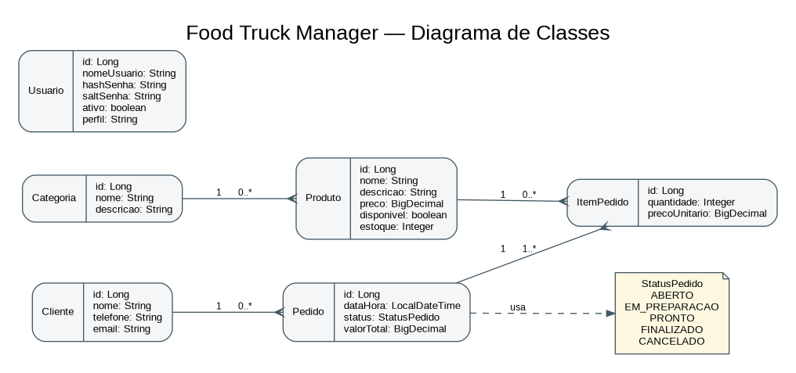

# Food Truck Manager

## Tema e finalidade
Aplicação desktop para administração de um food truck: cadastro de categorias, produtos e clientes, controle de estoque, registro e acompanhamento de pedidos, indicadores e relatórios.

## Problema e objetivo
O controle manual de pedidos, produtos e quantidades pode causar divergências de estoque, dificultar o acompanhamento das vendas e atrasar consultas gerenciais. O sistema centraliza essas operações em uma aplicação JavaFX com persistência SQLite.

## Integrante
- Trabalho individual
- Nome: **PREENCHER COM SEU NOME COMPLETO**

## Funcionalidades
- CRUD de categorias, produtos e clientes.
- Pedidos com cliente, vários produtos, quantidades, subtotais e total calculado.
- Atualização do status do pedido e consulta dos itens.
- Baixa automática de estoque ao salvar o pedido, validando disponibilidade e quantidade dentro da mesma transação.
- Reposição/ajuste de estoque e filtro de produtos com estoque baixo.
- Cancelamento de pedido com devolução das quantidades ao estoque, na mesma transação.
- Login com senha armazenada usando hash PBKDF2-HMAC-SHA256 e salt individual.
- Dashboard com indicadores de pedidos, faturamento, clientes atendidos, estoque baixo e gráfico de vendas por dia.
- Relatórios com filtros por intervalo de datas, cliente e status.
- Exportação dos pedidos filtrados para CSV (UTF-8, separador ponto e vírgula).
- Validação de entradas e mensagens de sucesso/erro.

## Acesso inicial
Na primeira execução, o sistema cria um administrador padrão:
- Usuário: `admin`
- Senha: `admin123`

**Altere a senha padrão antes de utilizar o sistema em um ambiente real.** O cadastro inicial é destinado à demonstração acadêmica; a versão atual não possui tela de administração de usuários ou troca de senha.

## Tecnologias
- Java 21
- JavaFX 21 e FXML
- Maven
- Jakarta Persistence (JPA) e Hibernate ORM 6.6
- SQLite
- PBKDF2-HMAC-SHA256 (API padrão do Java) para derivação de senha

## Arquitetura
```text
src/main/java/com/food_truck/
├── controller/    # Controllers JavaFX
├── model/         # Entidades JPA e enumerações
├── repository/    # Acesso a dados com EntityManager e transações
├── service/       # Regras de negócio e validações
├── security/      # Derivação e verificação de senhas
└── persistencia/  # EntityManagerFactory

src/main/resources/
├── META-INF/persistence.xml
└── view/          # Telas FXML

docs/
├── diagrama-classes.png
├── diagrama-classes.dot
└── imagens/       # Adicione capturas reais da aplicação
```

## Relacionamentos principais
- Uma `Categoria` possui vários `Produto`.
- Um `Cliente` possui vários `Pedido`.
- Um `Pedido` possui vários `ItemPedido`.
- Cada `ItemPedido` referencia um `Produto`.
- `Usuario` armazena as credenciais de acesso.

## Persistência e estoque
O banco local `foodtruck.db` é criado/atualizado pelo Hibernate (`hibernate.hbm2ddl.auto=update`). Ao iniciar uma base antiga, o Hibernate adiciona a coluna de estoque aos produtos; o valor padrão definido para produtos preexistentes é 100 unidades. Faça cópia de segurança antes de substituir ou alterar o arquivo. O projeto não usa JDBC diretamente: os repositórios utilizam JPA/EntityManager.

Ao registrar um pedido, o repositório carrega cliente e produtos gerenciados, confere o estoque e salva pedido, itens e baixa de estoque em uma única transação. Se ocorrer falha, a transação é revertida. Ao cancelar um pedido, as quantidades são devolvidas ao estoque dentro da transação de atualização do status.

## Pré-requisitos
- JDK 21
- Maven 3.9 ou superior

## Como configurar e executar
1. Clone o repositório e entre na pasta que contém `pom.xml`.
2. Compile:
   ```bash
   mvn clean compile
   ```
3. Execute:
   ```bash
   mvn javafx:run
   ```
4. Entre com as credenciais iniciais indicadas acima.

Os estilos visuais estão diretamente nos arquivos FXML; não há dependência de arquivo CSS.

## Diagrama de classes


## Capturas de tela
Adicione imagens reais em `docs/imagens/` e atualize os links abaixo:
- Login: `docs/imagens/login.png`
- Dashboard: `docs/imagens/dashboard.png`
- Produtos e estoque: `docs/imagens/produtos-estoque.png`
- Pedidos: `docs/imagens/pedidos.png`
- Relatórios: `docs/imagens/relatorios.png`

## Vídeo de apresentação
**PREENCHER COM O LINK DO VÍDEO NÃO LISTADO DO YOUTUBE (máximo de 5 minutos).**

Apresente o tema, objetivo, navegação, CRUDs, pedido com mais de uma entidade, persistência, validações, dashboard, filtros, exportação, autenticação e controle de estoque.

## GitHub e entrega
Publique o código-fonte em um repositório GitHub público ou acessível ao professor. Mantenha commits próprios e significativos durante o desenvolvimento. Não versione `target/`, `dist/`, arquivos de banco locais (`*.db`) nem credenciais. No Moodle, entregue somente o link do repositório.
